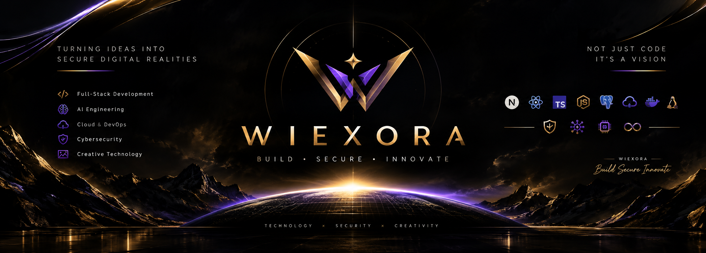

<div align="center">



<br>


<br><br>

# MD SOHAG CHOWDHURI

### Founder · Engineer · Builder

`Full-Stack` · `AI` · `Cloud` · `Cybersecurity`

<br>

**WIEXORA**

### `BUILD • SECURE • INNOVATE`

</div>

---

<div align="center">

> **Engineering systems at the intersection of software, intelligence, infrastructure and security.**

</div>

<br>

# ◈ 01 — THE ENGINEER

I’m **Md Sohag Chowdhuri**, founder of **WIEXORA** and a developer focused on building modern, scalable and secure digital systems.

My engineering direction is built around four interconnected domains:

```text
              ┌───────────────────┐
              │   SOFTWARE        │
              │   ENGINEERING     │
              └─────────┬─────────┘
                        │
        ┌───────────────┼───────────────┐
        ▼               ▼               ▼
     AI SYSTEMS     CLOUD SYSTEMS    SECURITY
        │               │               │
        └───────────────┼───────────────┘
                        ▼
              ┌───────────────────┐
              │      WIEXORA      │
              │ BUILD • SECURE    │
              │    • INNOVATE     │
              └───────────────────┘
```

I’m not interested in simply collecting technologies.

I want to understand:

**How systems work.  
How systems scale.  
How systems fail.  
How systems can be secured.**

---

# ◈ 02 — WIEXORA

<div align="center">

## WIEXORA

### `BUILD • SECURE • INNOVATE`

</div>

**WIEXORA** is my long-term technology vision.

A technology identity bringing together:

`Software Engineering` · `AI Engineering` · `Cloud & DevOps` · `Cybersecurity` · `Creative Technology`

The philosophy:

```text
BUILD
→ Create useful and scalable systems.

SECURE
→ Think about security from architecture to deployment.

INNOVATE
→ Use modern engineering and AI to create better solutions.
```

---

# ◈ 03 — THE ENGINEERING STACK

<div align="center">


</div>

### DEVELOPMENT

`JavaScript` · `TypeScript` · `React` · `Next.js` · `Node.js`

### DATA & BACKEND

`REST APIs` · `PostgreSQL` · `Prisma` · `Zod`

### CLOUD & DEVOPS

`Linux` · `Git` · `GitHub` · `Docker` · `CI/CD` · `Cloud Infrastructure`

### AI ENGINEERING

`AI Applications` · `AI Automation` · `AI Agents` · `Intelligent Systems`

### CYBERSECURITY

`Web Security` · `API Security` · `Vulnerability Assessment` · `Security Hardening` · `Ethical Hacking`

---

# ◈ 04 — WHAT I BUILD

<table>
<tr>
<td width="50%" valign="top">

## FULL-STACK

Modern web applications and scalable digital products.

**Focus**

`Next.js`  
`TypeScript`  
`React`  
`APIs`  
`Database Architecture`

</td>

<td width="50%" valign="top">

## AI ENGINEERING

Intelligent applications and automation systems.

**Focus**

`AI Applications`  
`AI Agents`  
`Automation`  
`Intelligent Workflows`

</td>
</tr>

<tr>
<td width="50%" valign="top">

## CLOUD & DEVOPS

Reliable deployment and infrastructure.

**Focus**

`Linux`  
`Docker`  
`CI/CD`  
`Cloud Infrastructure`

</td>

<td width="50%" valign="top">

## CYBERSECURITY

Security-focused engineering and continuous security learning.

**Focus**

`Web Security`  
`API Security`  
`Hardening`  
`Ethical Hacking`

</td>
</tr>
</table>

---

# ◈ 05 — ENGINEERING LOOP

<div align="center">

### UNDERSTAND

↓  

### ARCHITECT

↓

### BUILD

↓

### TEST

↓

### BREAK

↓

### SECURE

↓

### IMPROVE

</div>

I believe engineering is not about avoiding problems.

It is about becoming capable of **finding, understanding and solving them.**

---

# ◈ 06 — CURRENT TRAJECTORY

```text
                 ENGINEERING
                      │
        ┌─────────────┼─────────────┐
        ▼             ▼             ▼
     SOFTWARE        AI           CLOUD
        │             │             │
        └─────────────┼─────────────┘
                      │
                      ▼
                 CYBERSECURITY
                      │
                      ▼
                WIEXORA SYSTEMS
```

### Current direction

**01 — Full-Stack Development**

Building modern applications and strengthening software fundamentals.

**02 — Cloud & DevOps**

Learning deployment, infrastructure and production-oriented workflows.

**03 — AI Engineering**

Exploring intelligent applications, automation and AI-powered systems.

**04 — Cybersecurity**

Developing deeper understanding of application, API and system security.

---

# ◈ 07 — CREATIVE ENGINEERING

Before software engineering became my primary technical direction, I developed professional experience in **Adobe Photoshop and digital image editing**.

### VISUAL SPECIALIZATION

`High-End Retouching` · `Photo Manipulation` · `E-Commerce Editing`

`Wedding Editing` · `Product & Jewelry Editing` · `Ghost Mannequin`

`Background Removal` · `Object Removal` · `Color Correction`

`Portrait Retouching` · `Creative Compositing`

This background gives WIEXORA another dimension:

<div align="center">

### CODE

×

### DESIGN

×

### INTELLIGENCE

</div>

I see creative technology as another form of engineering:

**Precision + Structure + Visual Communication**

---

# ◈ 08 — FEATURED VISION

<div align="center">

## WIEXORA

### TECHNOLOGY · INTELLIGENCE · SECURITY

<br>

**Status**

`BUILDING`

<br>


</div>

---

# ◈ 09 — ENGINEERING PRINCIPLES

```text
01  Fundamentals > shortcuts

02  Understanding > memorization

03  Systems > isolated code

04  Security > afterthought

05  Practice > passive learning

06  Consistency > intensity

07  Improvement > perfection
```

### My rule

> **If I don't understand why something works, I don't consider it mastered.**

---

# ◈ 10 — GITHUB ACTIVITY

<div align="center">


</div>

<br>

<div align="center">


</div>

<br>

<div align="center">


</div>

---

# ◈ 11 — BEYOND THE CODE

I’m interested in the space where different disciplines meet:

```text
SOFTWARE
    +
AI
    +
CLOUD
    +
SECURITY
    +
DESIGN
```

The objective is not to become limited to one tool or one ecosystem.

The objective is to develop an **engineering mindset capable of moving across systems.**

---

# ◈ 12 — LONG-TERM MISSION

<div align="center">

## BUILD SYSTEMS

that are

### SCALABLE
### SECURE
### RELIABLE
### INTELLIGENT

<br>

and continuously

### EVOLVE.

</div>

---

# ◈ 13 — CONNECT

<div align="center">

### MD SOHAG CHOWDHURI

**Founder — WIEXORA**

<br>

<a href="https://github.com/sohag-wiexora">

</a>

<a href="mailto:mdsohagchowdhuri690@gmail.com">

</a>

<br><br>

`mdsohagchowdhuri690@gmail.com`

</div>

---

<div align="center">

<br>

# WIEXORA

### `BUILD • SECURE • INNOVATE`

<br>

> **Build with purpose. Secure by design. Innovate without limits.**

<br>


</div>
