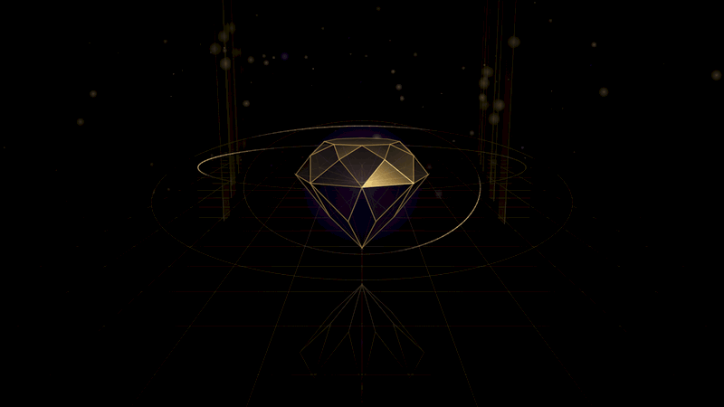
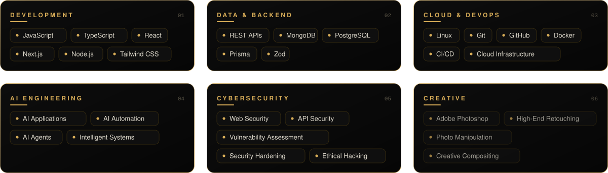
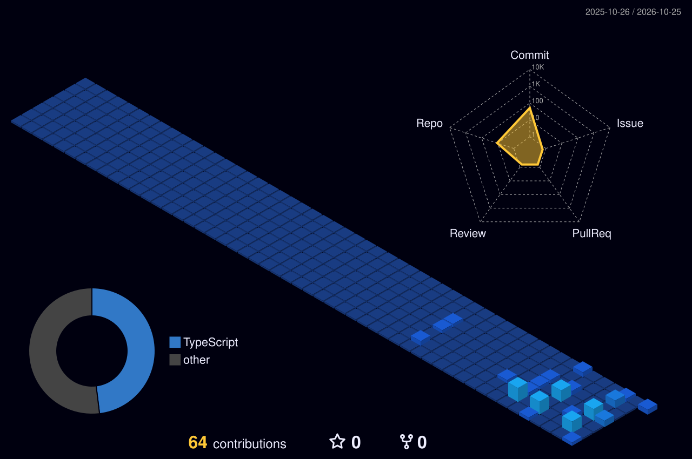

 

<table>
<tr>
<td width="34%" align="center" valign="middle">

</td>
<td valign="middle">

### Md Sohag Chowdhuri
**Founder · Engineer · Builder**

`Full-Stack` · `Cloud & DevOps` · `AI Engineering` · `Cybersecurity`

I'm the founder of **WIEXORA** and a developer focused on building modern, scalable and secure digital systems.

I'm not interested in simply collecting technologies. I want to understand **how systems work, how they scale, how they fail, and how they can be secured.**

**BUILD** — create useful and scalable systems. 
**SECURE** — think about security from architecture to deployment. 
**INNOVATE** — use modern engineering and AI to create better solutions.

</td>
</tr>
</table>

 

 

 

 

 

 

 

Before software engineering became my primary technical direction, I built professional experience in **Adobe Photoshop and digital image editing**: high-end retouching, photo manipulation, e-commerce, wedding, product and jewelry editing, ghost mannequin, background removal, object removal, color correction and creative compositing.

That background gives WIEXORA another dimension: **Code × Design × Intelligence**.

`Fundamentals > shortcuts` · `Understanding > memorization` · `Systems > isolated code` · `Security > afterthought` · `Practice > passive learning` · `Consistency > intensity` · `Improvement > perfection`

> **If I don't understand why something works, I don't consider it mastered.**

 

 

  

**Build with purpose. Secure by design. Innovate without limits.**

